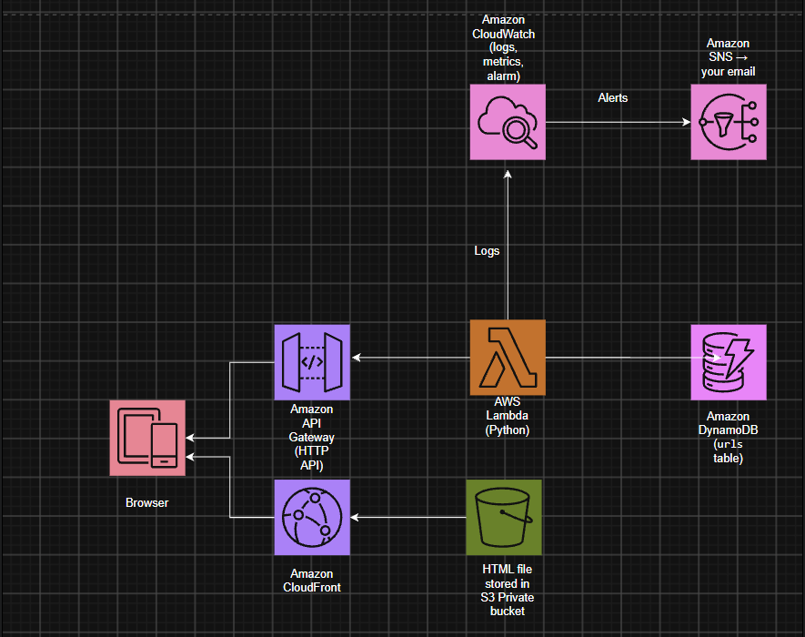

# Serverless URL Shortener on AWS

A URL shortener built on AWS Lambda, API Gateway, DynamoDB, S3 and CloudFront, then load-tested with k6 to find its real limits.

> **Note:** The live deployment was torn down after testing to avoid costs. Screenshots, load-test results and a demo video are included below.

## Architecture

<!-- TODO: draw this in draw.io (app.diagrams.net) with the AWS icon set and export it as docs/architecture.png -->

- **Frontend:** a static `index.html` in a **private** S3 bucket, served over HTTPS by CloudFront using Origin Access Control (OAC). The bucket is not publicly accessible.
- **API:** an API Gateway HTTP API with three routes, all integrated with a single Lambda function.
- **Compute:** one Python Lambda function that routes on `routeKey`.
- **Storage:** a DynamoDB table (`urls`) with `short_id` as the partition key, on on-demand capacity.
- **Monitoring:** CloudWatch Logs, plus a CloudWatch alarm on Lambda errors that emails via SNS.

## API

| Method | Path | Description | Response |
| --- | --- | --- | --- |
| POST | `/shorten` | Body `{"url": "https://..."}` | `201` with `code` and `short_url`; `400` for invalid input |
| GET | `/{code}` | Redirects to the original URL and increments its click count | `301` with `Location` header; `404` if unknown |
| GET | `/stats/{code}` | Returns the URL, click count and creation time | `200` JSON; `404` if unknown |

## Design decisions

- **Serverless over EC2:** no servers to manage, scales automatically, and costs nothing when idle.
- **DynamoDB on-demand:** single-key lookups fit a key-value store; on-demand capacity needs no sizing for spiky load.
- **Collision-safe codes:** each new code is written with `attribute_not_exists(short_id)`, so DynamoDB rejects a duplicate and the function retries with a new code.
- **Atomic click counting:** the redirect uses one `UpdateItem` call that increments `clicks` and returns the URL, avoiding a read-then-write race.
- **Least-privilege IAM:** the Lambda role can only `GetItem`, `PutItem` and `UpdateItem` on this one table ([policy](backend/iam-policy.json)).
- **Private S3 bucket with OAC:** only the CloudFront distribution can read the bucket ([policy](backend/s3-bucket-policy.json)).

## Load testing

Tested with [k6](https://k6.io) ([script](loadtest/loadtest.js)): 20 short links are created, then virtual users ramp up to a peak and request random redirects. Runs so far: 10, 50 and 100 peak users.

| Metric | Result |
| --- | --- |
| Peak concurrent users | 100 tested; only about 10 served at once, capped by the account limit of 10 concurrent Lambda executions |
| Sustained throughput | About 75–80 req/s successful redirects (up to 1,596 req/s attempted at 100 users) |
| p50 / p95 latency | 55 ms / 77 ms (successful requests, 10 users, Bengaluru to ap-south-2) |
| Error rate | 46% at 10 users, 80% at 50, 95% at 100 (Lambda throttling) |
| Lambda cold start vs warm duration | 358 ms init + 372 ms handler (about 730 ms total, 128 MB) vs 35 ms warm (single sample) |

Full results per run: [docs/load-test-results](docs/load-test-results/README.md)

## Challenges and fixes

<!-- TODO: confirm each root cause and fix in your own words; interviewers will ask about these. -->

1. **`Internal Server Error` from the API.** TODO: the error shown in CloudWatch Logs and what you changed.
2. **CloudFront returned `AccessDenied`.** TODO: which cause it was (bucket policy for OAC, default root object, origin settings) and the fix.
3. **CORS preflight blocked by the browser.** The browser's `OPTIONS` preflight got no `Access-Control-Allow-Origin` header. TODO: the exact misconfiguration in API Gateway CORS and the fix.
4. **80% of requests failed under load.** The first k6 run at 50 virtual users reached about 372 req/s with a p95 of 143 ms, but 80% of requests failed quickly. API Gateway returned `503 Service Unavailable`, and the Lambda Throttles metric peaked in every run. `aws lambda get-account-settings` showed `ConcurrentExecutions: 10`, a reduced limit AWS gives some new accounts (the standard default is 1,000). Reruns confirmed it: successful redirects stayed at about 75–80 req/s at both 10 and 100 users, while the error rate rose from 46% to 95%. Fix: request a Lambda concurrency quota increase in Service Quotas. TODO: the new limit and the highest load with near-zero errors after the increase.

## Running it yourself

1. Create a DynamoDB table `urls` with partition key `short_id` (String), on-demand.
2. Create a Python Lambda from [backend/lambda_function.py](backend/lambda_function.py) with the environment variable `TABLE_NAME=urls`, and attach [backend/iam-policy.json](backend/iam-policy.json) to its role.
3. Create an HTTP API in API Gateway with the three routes above, integrated with the Lambda, and enable CORS for `GET`, `POST` and the `content-type` header.
4. Put your API URL into [frontend/index.html](frontend/index.html), upload it to a private S3 bucket, and serve it through CloudFront with OAC.
5. Load test: `k6 run -e API=<your-api-url> loadtest/loadtest.js`

Test the Lambda directly with [backend/test-event.json](backend/test-event.json).

## Possible improvements

- Rebuild the infrastructure with Terraform
- Cache redirects at CloudFront to cut Lambda calls and latency
- Rate limiting with API Gateway throttling
- Link expiry with DynamoDB TTL
- Custom domain with Route 53 and ACM
- CI/CD with GitHub Actions and unit tests

## Tech stack

AWS Lambda (Python) · API Gateway (HTTP API) · DynamoDB · S3 · CloudFront · IAM · CloudWatch · SNS · k6
